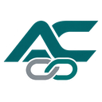

# AraanCo Link Manager 🔗

**A lightweight, free, open-source Chrome link organizer — English & فارسی, offline-first, with optional Chrome Sync.**


<p align="center"></p>

[English](#english) · [فارسی](#فارسی)

## English

AraanCo Link Manager is a **local-first** Chrome extension for storing and organizing your favorite or frequently used links. It runs without a backend and without a separate account. You can optionally sync saved links between Chrome profiles using **Chrome Sync**. The default interface language is English; Persian is available at any time.

### Features

- Add, edit, delete, categorize and search links
- Add the current Chrome tab to the form in one click
- Open links or all links in a category (with safeguards for many tabs)
- Check for duplicates and reject unsupported or unsafe URL schemes
- Export/import JSON backups
- Light / dark mode, plus English (LTR) / Persian (RTL)
- Local offline storage with optional cross-device Chrome Sync
- The **same extension ID** for unpacked installs on different devices
- No analytics, advertising, or extension-specific cloud server

### Install without Chrome Web Store

1. Click **Code → Download ZIP** to download the latest source (including the ready-to-load extension).
2. Unzip into a **permanent folder**.
3. Open `chrome://extensions` in Chrome and enable **Developer mode**.
4. Click **Load unpacked** and select the folder containing `manifest.json` (not its parent folder).
5. Optionally pin the extension to the toolbar.

> **Updates are manual.** To update an existing unpacked installation, extract the new version **over the files in the existing extension folder**, then click **Reload** on `chrome://extensions`. Do **not** uninstall just to update, or local storage may be lost. Export JSON first if in doubt.

### Sync between devices

1. Sign into Chrome on each device and enable the relevant **Chrome Sync** setting.
2. Install this extension with the same `manifest.json` public `key` (and hence the same extension ID) on each device.
3. In each extension popup, enable **Sync with Chrome Sync**.
4. Changes to links will sync with Chrome's normal synchronization behavior; they are not necessarily instantaneous.

**Sync only applies to links, not to installing or upgrading the extension.** Sync capacity is limited (roughly 100 KiB total, 8 KiB per item, max 512 items). Language and theme preferences remain device-local. The extension's stable ID is `egchhoacegbnemfiefalngedpfkaepic`.

### Privacy & security

- Saved URLs reside locally in Chrome unless you opt into Chrome Sync. If enabled, private/intranet URLs may be stored in your Google account's Chrome Sync storage.
- Avoid putting passwords, tokens or access keys into URLs. JSON exports contain your URLs in plaintext.
- The `manifest.key` is an **RSA public key**, **not** a secret. Never commit private signing keys.
- The extension requests only `storage` and `activeTab` permissions.
- Chrome Sync does not replace a separate backup. Use Export JSON periodically.

### Development

No external JavaScript framework or build step is required.

```bash
node --test tests/*.test.mjs
```

Chrome Manifest V3 · JavaScript modules · English and Persian translations · MIT License.

## فارسی

**AraanCo Link Manager** یک افزونه رایگان و متن‌باز کروم برای ذخیره، دسته‌بندی و جست‌وجوی لینک‌هاست. بدون سرور مستقل کار می‌کند و **زبان پیش‌فرض انگلیسی** است؛ فارسی را می‌توان از داخل افزونه انتخاب کرد.

### امکانات

- افزودن، ویرایش و حذف لینک‌ها و دسته‌بندی آن‌ها
- جست‌وجوی سریع و افزودن تب فعلی مرورگر
- ذخیره نسخه پشتیبان و بازیابی از فایل JSON
- تشخیص لینک تکراری و اعتبارسنجی نشانی‌ها
- حالت تاریک و روشن و پشتیبانی راست‌به‌چپ / چپ‌به‌راست
- ذخیره آفلاین و **سینک اختیاری بین دستگاه‌ها** با Chrome Sync
- نصب دستی و رایگان، بدون نیاز به Chrome Web Store

### روش نصب

۱. از قسمت **Code → Download ZIP** فایل پروژه را دریافت و در پوشه‌ای ثابت Extract کنید.
۲. در کروم وارد `chrome://extensions` شوید و **Developer mode** را روشن کنید.
۳. روی **Load unpacked** بزنید و پوشه حاوی `manifest.json` را انتخاب کنید.
۴. برای همگام‌سازی لینک‌ها، Chrome Sync حساب گوگل و گزینه Sync داخل افزونه را در هر دستگاه فعال کنید.

**برای آپدیت:** فایل‌های نسخه جدید را در **همان پوشه قبلی** جایگزین و افزونه را Reload کنید؛ از حذف افزونه برای ارتقا خودداری کنید. بهتر است قبل از تغییرات مهم، خروجی JSON بگیرید.

> همگام‌سازی می‌تواند آدرس سامانه‌های داخلی را به فضای Chrome Sync حساب شما منتقل کند؛ بنابراین از ذخیره URLهای حاوی رمز، توکن یا کلید دسترسی خودداری کنید. زبان و تم به‌صورت محلی برای هر دستگاه ذخیره می‌شوند.

### توسعه و همکاری

تست‌ها با Node.js نسخه ۲۰ یا جدیدتر:

```bash
node --test tests/*.test.mjs
```

پیشنهادها، گزارش باگ و Pull Request پذیرفته می‌شوند. قبل از ارسال گزارش، اطلاعات حساس یا لینک‌های خصوصی را از تصاویر و لاگ‌ها حذف کنید.

**مجوز انتشار کد: MIT** · ساخته‌شده برای استفاده شخصی و جامعه کاربران، با برند AraanCo.
